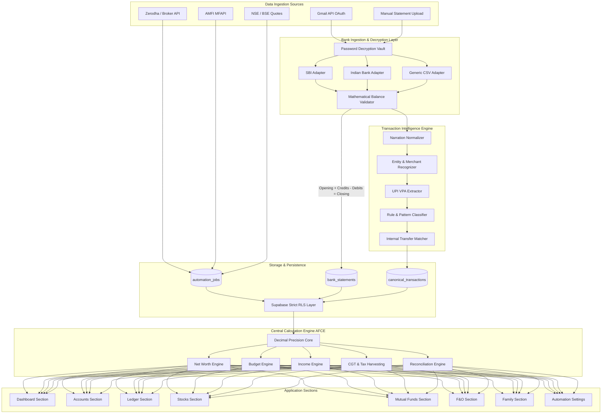

# ARTHAX — UNIVERSAL FINANCIAL AUTOMATION & DATA ARCHITECTURE

**Specification Version**: 2.0.0  
**Status**: Experimental Architecture Implementation  
**Target Branch**: `experiment/complete-automation`  

---

## 1. ARCHITECTURAL OVERVIEW & DATA FLOW

ArthaX implements a unified, reactive, and mathematically verified pipeline that transforms messy, real-world financial artifacts (e-statements, bank alerts, broker APIs) into clean, reconciled financial intelligence.

---

## 2. CANONICAL TRANSACTION DATA MODEL

Every transaction ingested across any bank statement or channel is mapped into `canonical_transactions`:

| Attribute | Type | Description |
|---|---|---|
| `id` | `uuid` | Globally unique transaction identifier. |
| `user_id` | `text` | Multi-tenant user identifier isolated by Supabase RLS. |
| `account_id` | `uuid` | Foreign key referencing `accounts.id`. |
| `statement_id` | `uuid` | Foreign key referencing source `bank_statements.id`. |
| `transaction_date` | `date` | Transaction execution date (ISO `YYYY-MM-DD`). |
| `value_date` | `date` | Clearing or value date where provided by bank. |
| `amount` | `numeric(15, 2)` | Absolute currency value strictly > 0.00. |
| `currency` | `text` | ISO 4217 currency code (default: `INR`). |
| `direction` | `text` | `DEBIT` (money out) or `CREDIT` (money in). |
| `original_narration` | `text` | Immutable, verbatim narration as extracted from bank file. |
| `normalized_narration`| `text` | Cleaned alphanumeric string stripped of noise, reference tags, and whitespace. |
| `transaction_reference`| `text` | Bank UTR, UPI transaction reference, or cheque number. |
| `counterparty_name` | `text` | Extracted individual or entity name. |
| `counterparty_identifier`| `text` | UPI VPA (e.g., `user@okaxis`), masked account or card number. |
| `merchant_name` | `text` | Cleaned brand/merchant name (e.g., `Swiggy`, `Amazon`, `Uber`). |
| `merchant_category` | `text` | Merchant industry category (e.g., `Food & Dining`, `E-Commerce`). |
| `channel` | `text` | Ingestion channel: `UPI`, `NEFT`, `RTGS`, `IMPS`, `POS`, `ATM`, `NET_BANKING`, `CHEQUE`, `CHARGES`, `OTHER`. |
| `category` | `text` | High-level categorization used for budgeting and cash flow. |
| `transaction_type` | `text` | Granular financial intent (e.g. `SALARY`, `FOOD_DINING`, `OWN_ACCOUNT_TRANSFER`, `REFUND`). |
| `classification_confidence` | `numeric(5, 4)` | Calibrated statistical/rule confidence score (0.0000 to 1.0000). |
| `classification_reason` | `text` | Explainable justification string (e.g., `RULE:UPI_MERCHANT_VPA_MATCH:swiggy`). |
| `is_transfer` | `boolean` | `true` if transaction represents an internal transfer between user's accounts. |
| `transfer_counterpart_id` | `uuid` | Linked twin transaction in counterparty account. |
| `dedup_hash` | `text` | Idempotency hash: `sha256(account_id:date:amount:direction:ref_or_narration)`. |

---

## 3. IDEMPOTENCY & DEDUPLICATION STRATEGY

To allow statements and Gmail attachments to be scanned repeatedly without creating duplicate transactions:
1. **File-Level Deduplication**:  
   The SHA-256 hash of the statement file content is computed before parsing. If `bank_statements` already contains `(user_id, file_hash)`, the file is safely skipped with a `DUPLICATE_FILE` response.
2. **Transaction-Level Deduplication**:  
   For each transaction, a unique hash is generated:
   $$\text{dedup\_hash} = \text{SHA256}(\text{account\_id} \parallel \text{date} \parallel \text{amount} \parallel \text{direction} \parallel \text{coalesce}(\text{ref}, \text{normalized\_narration}))$$
   An `INSERT ... ON CONFLICT (user_id, dedup_hash) DO NOTHING` pattern guarantees duplicate imports are ignored while new rows are added.

---

## 4. SECURE PASSWORD DECRYPTION LIFECYCLE

Bank statements from Indian banks (SBI, Indian Bank) are frequently encrypted with passwords derived from customer profile details:
- **SBI e-Statements**: Date of birth (DDMM) + Last 5 digits of registered mobile number (or PAN).
- **Indian Bank e-Statements**: Account number or Date of birth + mobile digits.

### Security Guarantees
1. **Zero Plaintext Storage**: User password hints are encrypted at rest in PostgreSQL using AES-256-GCM (`src/utils/crypto.ts`) with `ENCRYPTION_KEY`.
2. **Zero Plaintext Logging**: Password variables and decrypted buffers are strictly masked in logs and monitoring payloads.
3. **In-Memory & Ephemeral Temp Decryption**: PDFs are decrypted using PyMuPDF / `pypdf` in an isolated memory buffer or ephemeral temp file (`tempfile.NamedTemporaryFile`).
4. **Immediate Cleanup**: Temporary files and decrypted buffers are purged immediately upon parsing completion inside `finally` blocks.
5. **No External LLM Exposure**: Passwords and decrypted statement buffers are never transmitted to external AI endpoints.

---

## 5. MATHEMATICAL STATEMENT VALIDATION

Before any statement is marked as `RECONCILED`:
$$\text{Opening Balance} + \sum \text{Credits} - \sum \text{Debits} \equiv \text{Closing Balance} \quad (\pm 0.01 \text{ INR})$$

Additionally, the engine runs:
- **Transaction Count Verification**: Extracted rows count must equal bank reported transaction count where available.
- **Consecutive Statement Continuity**:
  $$\text{Opening Balance}_{t} \equiv \text{Closing Balance}_{t-1}$$
  If a gap is detected, a `MISSING_INTERMEDIATE_PERIOD` warning is flagged to prompt the user for the missing month's statement.
