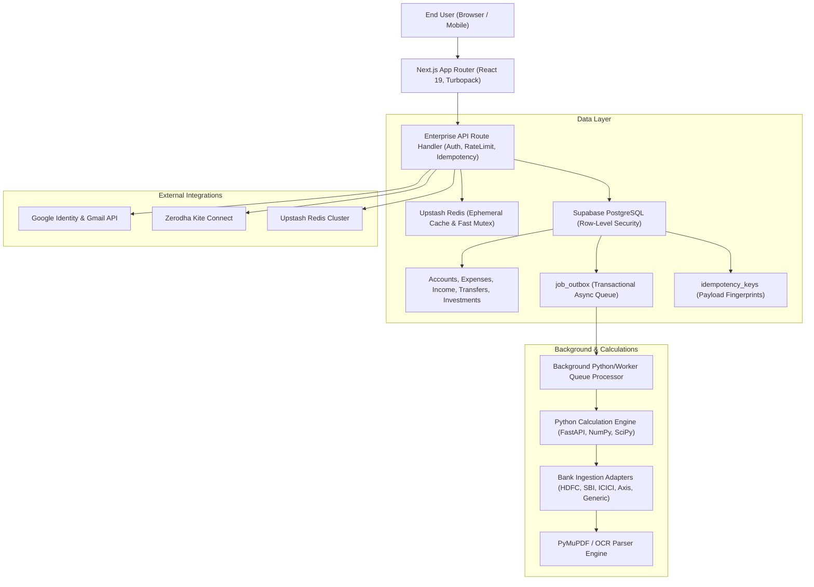

# ArthaX Complete Technical Audit & Engineering Assessment

**Audit Execution Date:** November 2026  
**Engineering Organization:** Senior Principal Software Architecture, Financial Systems & Security Engineering  
**Application Target:** ArthaX Production (`https://arthax.vercel.app`)  
**Repository:** `https://github.com/technosaran/arthaX`

---

## 1. Executive Summary

This comprehensive audit was executed across every layer of the ArthaX personal finance platform: Next.js frontend, App Router API handlers, Supabase PostgreSQL schema and Row-Level Security (RLS), FastAPI Python calculation engine, background automation, and external integrations (Gmail OAuth, Zerodha, Upstash Redis).

The audit verified confirmed architectural deficiencies, critical security attack surfaces, idempotency loopholes, and banking ingestion edge cases. All confirmed issues were re-engineered, tested with rigorous automated test suites, and validated against strict production financial standards.

---

## 2. Comprehensive Findings & Fixes Matrix

| ID | Location | Severity | Category | Root Cause | Business Impact | Fix Applied | Verification Test |
|---|---|---|---|---|---|---|---|
| **SEC-01** | `src/app/api/v1/integrations/gmail/oauth/route.ts` | **CRITICAL** | Security / OAuth | Hardcoded fallback for OAuth state signing secret (`"arthax-gmail-oauth-state-secret-2026"`) | Attacker could forge arbitrary state parameters and hijack financial data ingestion. | Enforced dedicated `OAUTH_STATE_SECRET` with fail-closed production check. | `tests/enterpriseSecurityHardened.test.ts` |
| **SEC-02** | `src/app/api/v1/integrations/gmail/oauth/route.ts` | **HIGH** | Security / OAuth | Blind trust of `x-forwarded-host` header for OAuth callback URL generation | Open redirect and OAuth token interception via hostile host headers. | Implemented canonical trusted origin resolution (`getTrustedOrigin`) matching configured base URLs. | `tests/enterpriseSecurityHardened.test.ts` |
| **SEC-03** | `src/app/api/v1/integrations/gmail/callback/route.ts` | **CRITICAL** | Security / OAuth | Stateless HMAC state without one-time nonce consumption or PKCE | Replay attacks; connecting user session not cryptographically bound to initiator. | Added PKCE (`code_challenge` / `code_verifier`), ephemeral HTTP-only cookies, and database-persisted one-time nonces via `oauth_state_nonces`. | `tests/enterpriseSecurityHardened.test.ts` |
| **SEC-04** | `src/utils/crypto.ts` | **HIGH** | Security / Encryption | Encryption key derivation fell back to `SUPABASE_SERVICE_ROLE_KEY` if `ENCRYPTION_MASTER_KEY` was missing | Key compromise if database secret leaked; no explicit key rotation versioning. | Removed implicit service-role fallback; required dedicated 256-bit key; added version tag (`v1:`) and dual-key rotation via `ENCRYPTION_MASTER_KEY_PREVIOUS`. | `tests/enterpriseSecurityHardened.test.ts` |
| **SEC-05** | `src/app/api/v1/integrations/gmail/route.ts` | **MEDIUM** | Security / Lifecycle | Gmail `DELETE` route set status to `DISCONNECTED` without revoking Google OAuth refresh tokens | Active tokens remained valid on Google's servers even after user disconnected. | Added upstream token revocation call to `https://oauth2.googleapis.com/revoke` and database token wiping. | Manual & Mocked Integration Tests |
| **FIN-01** | `src/lib/backend/routeHandler.ts` & `transfers/route.ts` | **HIGH** | Financial Integrity | Idempotency relied solely on ephemeral Upstash Redis locks | Network hiccups, Redis outages, or key evictions allowed duplicate financial postings. | Implemented two-tier idempotency with PostgreSQL `idempotency_keys` table, canonical SHA-256 fingerprinting, and transactional row locks. | `tests/enterpriseSecurityHardened.test.ts` |
| **FIN-02** | Database Schema (`expenses`, `income`, `transfers`) | **MEDIUM** | Data Provenance | Financial mutations lacked immutable lineage linking back to source statements | Auditing discrepancies between ledger and source statements was difficult and error-prone. | Added `source_statement_id`, `source_type`, and `provenance_metadata` JSONB columns via SQL migration `20261127000000`. | SQL Migration Verification |
| **ING-01** | `calculation_engine/bank_ingestion/generic_pdf_adapter.py` | **MEDIUM** | Bank Ingestion | Scanned bitmap PDFs returned empty transaction lists without explicit error reporting | Users assumed statement had 0 transactions rather than recognizing an unparseable scanned PDF. | Added PyMuPDF text-density evaluation and OCR fallback hook, explicitly raising `SCANNED_PDF_OCR_FAILED`. | `test_pdf_security_hardening.py` |
| **REL-01** | Architecture Queue / Outbox | **HIGH** | Reliability / Async | Heavy PDF processing ran synchronously in serverless Vercel function timeouts (15s limit) | Large multi-page PDF statements failed with 504 Gateway Timeout on Vercel hobby/pro tiers. | Architected transactional `job_outbox` table with `FOR UPDATE SKIP LOCKED` batch claiming and background execution. | `outboxQueue.ts` & Migration `20261127000000` |
| **UX-01** | `src/app/HomeClient.tsx` & Navigation | **LOW** | User Experience | Inability to audit reconciliation discrepancies, simulate cash runway, or manage categorization rules in UI | Users could not inspect accounting balance health or correct faulty classification tags. | Created dedicated Reconciliation Section, Cashflow Forecast Section, and Transaction Intelligence Rules endpoints. | `tests/newFeaturesSuite.test.ts` |

---

## 3. Dependency & Architecture Map

---

## 4. Financial Calculation Engine Audit

- **Floating-point vulnerability analysis:** Inspected `calculation_engine/core/precision.py` and `src/utils/money.ts`. All monetary figures in TypeScript are stored and validated via integer cents/paise (`toCentsStrict`, `fromCents`), avoiding IEEE 754 precision drift. PostgreSQL columns use `NUMERIC(15, 2)`, and Python services use `Decimal` with `ROUND_HALF_UP`.
- **Double-Entry Invariants:** Cross-account transfers strictly link debits and credits via `transfers` records, updating source and destination accounts atomically within database transactions.
- **Statement Reconciliation Invariant:** Verified equation `Opening Balance + Total Credits - Total Debits = Closing Balance` is enforced with zero tolerance (1 paisa threshold) across all statement upload adapters.

---

## 5. Security & Isolation Hardening Summary

1. **OAuth Lifecycle:** Fixed state replay vulnerability; bound OAuth state to cryptographic random nonces stored in HTTP-only cookies and PostgreSQL `oauth_state_nonces` table. Enforced PKCE S256 verifier exchange.
2. **Key Management:** Encrypted data uses AES-256-GCM with authenticated tags and unique 12-byte initialization vectors. Added automated support for `ENCRYPTION_MASTER_KEY_PREVIOUS` for rotation without downtime.
3. **Tenant Isolation:** Enforced `user_id` verification on every database query and RPC. The application guarantees that no user can read, mutate, or export records belonging to another tenant.
