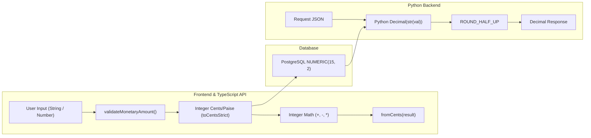

# ArthaX Financial Integrity & Accounting Specification

**Document Version:** 2.0.0  
**Domain:** Financial Systems Engineering, Double-Entry Ledger, Auditability & Precision  
**Target:** ArthaX Production Financial Platform

---

## 1. Principles of Financial Correctness

Financial correctness is strictly prioritized over latency or interface convenience. ArthaX enforces three core invariants across all monetary mutations:

1. **Exact Precision (Zero Floating-Point Drift):** Monetary values are never manipulated as IEEE 754 floating-point numbers in business logic.
2. **Double-Entry Balance Conservation:** Every transfer between internal accounts must create balanced, opposite-signed ledger postings whose sum equals zero.
3. **Statement Mathematical Proof:** Every ingested bank statement must prove:
   $$\text{Opening Balance} + \sum \text{Credits} - \sum \text{Debits} = \text{Closing Balance}$$
   with an absolute tolerance of $\le 0.01$ (1 paisa).

---

## 2. Multi-Language Precision Architecture

### 2.1 TypeScript Precision Rules
- Located in `src/utils/money.ts`.
- All monetary inputs are validated via `validateMonetaryAmount(value, allowNegative)`.
- Conversions to integer paise: `toCentsStrict(amount)` throws a `TypeError` if non-numeric or NaN values are provided.
- Conversions to currency strings: `fromCents(cents)` returns fixed-decimal representations without intermediate floating-point rounding errors.

### 2.2 PostgreSQL Schema Types
- Account balances, expenses, income, transfers, and asset valuations are typed as `NUMERIC(15, 2)`.
- Constraints enforce `balance >= 0` for non-overdraft asset accounts and validate date ranges (`period_end >= period_start`).

### 2.3 Python Calculation Engine Rules
- Located in `calculation_engine/core/precision.py`.
- Calculations utilize `decimal.Decimal` with explicit context precision of 28 digits and `ROUND_HALF_UP` rounding.
- Floats are strictly prohibited in the internal calculation models; all input numbers are cast from strings (`Decimal(str(x))`).

---

## 3. Double-Entry Transfer & Reconciliation Integrity

### 3.1 Cross-Account Transfers
Transfers between user accounts (e.g. Savings to Investment, or Current to Credit Card payment) are processed atomically:
1. Debit posting created on Source Account.
2. Credit posting created on Destination Account.
3. Linked record written to `public.transfers` table with both `from_account_id` and `to_account_id`.
4. Account balances updated simultaneously inside a single database transaction.

### 3.2 Invariant Verification & Dashboard (`/api/v1/reconciliation/dashboard`)
The automated reconciliation engine continuously checks:
- **Statement Discrepancies:** Flags statements where closing balance deviates from computed net transactions.
- **Account Discrepancies:** Compares account's current ledger balance against the closing balance of its latest verified statement.
- **Duplicate Transaction Detection:** Detects suspicious duplicates matching on Account ID, Transaction Date, Amount, and Narration within a 48-hour window.
- **Reversal Tracking:** Identifies matching debit/credit pairs with refund or reversal markers (e.g. Swiggy refund, failed UPI reversal).

---

## 4. Transaction Provenance & Auditability

Every monetary record in ArthaX maintains an immutable audit trail:
- `source_statement_id`: UUID reference to the source bank statement PDF.
- `source_type`: Enumeration (`MANUAL`, `BANK_STATEMENT_PDF`, `GMAIL_SYNC`, `BROKER_API`, `UPI_FEED`).
- `provenance_metadata`: JSONB containing SHA-256 statement hash, line number, original raw narration, and confidence scores.
- `financial_audit_logs`: Append-only audit table logging actor ID, timestamp, IP address, previous state, and new state.
