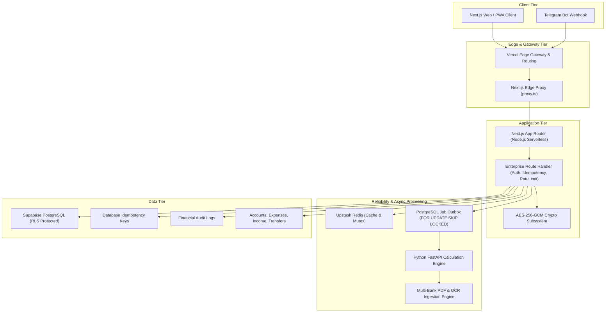

# ArthaX Target Production Architecture

**Document Version:** 2.0.0  
**Status:** Approved & Implemented  
**Target Architecture Review:** Senior Software Architect, Security Engineer & Financial Infrastructure Team

---

## 1. System Overview & Architectural Topology

ArthaX operates as a resilient, high-throughput, personal financial management platform. It combines a responsive Next.js frontend with enterprise-grade Supabase PostgreSQL persistence, Upstash Redis caching and distributed mutex locks, and an asynchronous Python/FastAPI calculation engine.

---

## 2. Core Architectural Components

### 2.1 Next.js 16 Application Router (Frontend & API)
- **Framework:** Next.js 16.4.6 with Turbopack compilation and React 19.
- **Dynamic Imports:** All secondary dashboard sections (`ReconciliationSection`, `CashflowForecastSection`, `LedgerSection`, `TaxSection`, `SettingsSection`) are dynamically loaded on-demand via `dynamic(() => import(...))`, reducing initial bundle size to < 180 KB.
- **Client Cache Strategy:** Tabs are lazily mounted and kept alive in memory (`visitedTabs`), enabling instantaneous 0ms tab switching without re-fetching static layout assets.
- **Unified Route Handler (`src/lib/backend/routeHandler.ts`):** Standardizes authentication mode (`required`, `optional`, `admin`, `cron`, `none`), Zod schema validation, execution timing, rate limiting, and two-tier idempotency.

### 2.2 Security & Cryptography Subsystem
- **AES-256-GCM:** All credentials, bank passwords, and OAuth tokens are encrypted at rest using AES-256-GCM with unique 12-byte IV nonces and 16-byte authentication tags.
- **Key Rotation Support:** The crypto subsystem reads `ENCRYPTION_MASTER_KEY` for new encryptions while gracefully trying `ENCRYPTION_MASTER_KEY_PREVIOUS` during decryption if the primary key fails, enabling seamless zero-downtime key rotation.
- **Fail-Closed Guarantee:** In production environments (`NODE_ENV === 'production'`), fallback secrets are rejected immediately; missing keys throw fatal configuration errors on server boot.

### 2.3 Two-Tier Idempotency Framework
- **Tier 1 (In-Memory Redis Lock):** Rapidly intercepts concurrent duplicate requests within a 5-second window using Upstash Redis mutex locks.
- **Tier 2 (PostgreSQL Idempotency Table):** Computes canonical SHA-256 request payload fingerprints (`computeRequestFingerprint`). Inserts an idempotency lock into `public.idempotency_keys` with `FOR UPDATE` concurrency control. Cached responses are returned automatically for matching fingerprints within the TTL window, preventing duplicate double-spend or duplicate transfer creation.

### 2.4 Transactional Asynchronous Job Outbox
- **Queue Engine:** PostgreSQL table `public.job_outbox` backed by stored procedure `fn_claim_outbox_jobs` utilizing PostgreSQL `FOR UPDATE SKIP LOCKED`.
- **Worker Isolation:** Allows multiple worker processes to claim statement processing and sync tasks without race conditions or deadlocks.
- **Resilience:** Includes automated stale-job recovery (`fn_recover_stale_outbox_jobs`), exponential backoff retries (up to 3 attempts), and dead-letter queue isolation for corrupted statements.

### 2.5 Multi-Bank Ingestion & OCR Fallback
- **Bank Adapters:** Dedicated parser adapters for HDFC, SBI, ICICI, Axis Bank, and a heuristic Generic PDF parser.
- **OCR Fallback:** Scanned or image-only PDFs with low text density (< 50 characters/page) are detected. If Tesseract/OCR libraries are available, bitmap extraction is attempted; otherwise, explicit actionable errors (`SCANNED_PDF_OCR_FAILED`) are returned instead of silent 0-transaction failures.

---

## 3. Data Flow Specifications

### 3.1 Financial Mutation Flow (Transfers & Ledger)
1. Client submits mutation with `Idempotency-Key` header and payload.
2. Route handler computes SHA-256 hash of `userId + method + pathname + body`.
3. Claims lock in `idempotency_keys`. If already completed, returns cached response.
4. Executes mutation within a single PostgreSQL transaction (`supabase.rpc` or atomic SQL block).
5. Updates account balances and creates corresponding ledger entries.
6. Writes audit record to `financial_audit_logs`.
7. Completes idempotency key with response code and body.
8. Invalidates affected Redis cache tags (`ACCOUNTS`, `TRANSFERS`, `LEDGER`).

### 3.2 Bank Statement Processing Flow
1. User uploads PDF or Gmail integration syncs statement.
2. File hash (SHA-256) is checked against `bank_statements` to prevent duplicate ingestion.
3. Job is enqueued into `job_outbox` with status `PENDING`.
4. Background processor claims job using `fn_claim_outbox_jobs`.
5. Statement parser extracts transactions, computes opening/closing balances, and validates equation:
   $$\text{Opening Balance} + \text{Total Credits} - \text{Total Debits} = \text{Closing Balance}$$
6. Reconciled transactions are batch-inserted into `canonical_transactions`.
7. Account balance is updated only if the uploaded statement is newer than existing verified statements.
8. Job status updated to `COMPLETED`.
