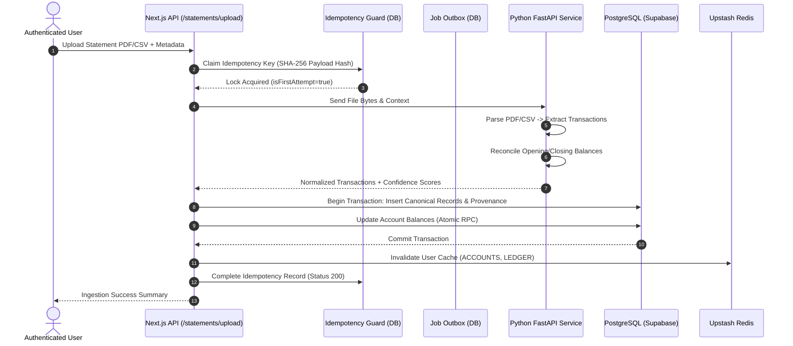
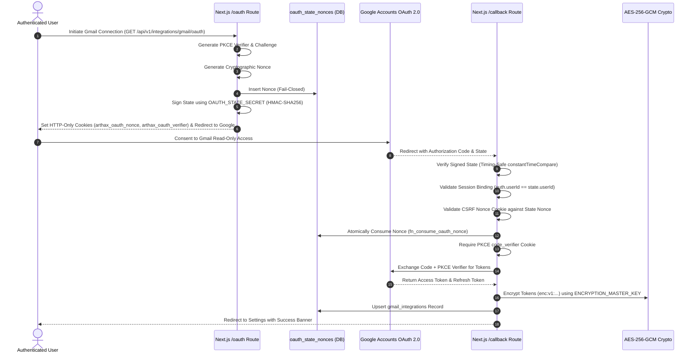
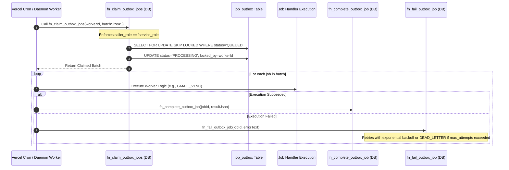

# ArthaX — Data Flow & Lifecycle Specifications

**Date**: November 22, 2026  
**Version**: 2.4.0

---

## 1. Bank Statement Ingestion & Reconciliation Flow

---

## 2. Hardened Google OAuth & Gmail Synchronization Flow

---

## 3. Transactional Outbox Worker Processing Flow

