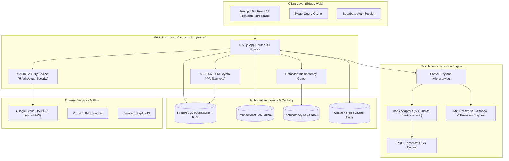

# ArthaX — Target Architecture & System Design

**Date**: November 22, 2026  
**Architecture Version**: 2.4.0  
**Status**: Active Production Standard

---

## 1. System Topology & Technology Stack

ArthaX is engineered as a resilient, high-performance personal finance platform leveraging modern serverless, database, and asynchronous processing primitives.

---

## 2. Core Architectural Components

### A. Next.js 16 Frontend & API
- **Frontend**: Responsive UI built with Tailwind CSS, Lucide icons, and React 19 server/client components.
- **API Routes**: Handle client authentication, rate limiting, session binding, and coordination between database and calculation services.

### B. PostgreSQL & Row Level Security (Supabase)
- **Authoritative Datastore**: All financial records, accounts, transactions, investments, and settings are stored in PostgreSQL.
- **Tenant Isolation**: RLS is strictly enforced on all user-owned tables via `auth.uid()::text = user_id`.
- **Database Idempotency**: `idempotency_keys` table with atomic row locking (`FOR UPDATE`) prevents duplicate operations.
- **Durable Job Outbox**: `job_outbox` table decouples heavy statement processing and bank synchronizations from synchronous API requests.

### C. Python FastAPI Engine
- **Dedicated Mathematical Precision**: Handles high-performance PDF/CSV parsing, OCR, and complex tax/investment calculations using Python's `decimal.Decimal` library.
- **Worker Isolation**: Internal API endpoints enforce security headers and bounds on PDF pages, upload sizes, and processing timeouts.

### D. Upstash Redis Caching
- **Cache-Aside Pattern**: Ephemeral caching for hot analytical queries, stock quotes, and integration metadata.
- **Security Invariant**: Cache keys are strictly namespaced by user ID (`user:{userId}:portfolio`). Mutations trigger immediate cache invalidation via `invalidateUserCaches()`.

### E. Cryptography & OAuth Security
- **Data at Rest**: Sensitive credentials (broker tokens, passwords, Gmail tokens) are encrypted with AES-256-GCM versioned envelopes (`enc:v1:...`).
- **OAuth Hardening**: Enforces dedicated `OAUTH_STATE_SECRET`, session binding, mandatory CSRF cookies, and required PKCE verifiers.
